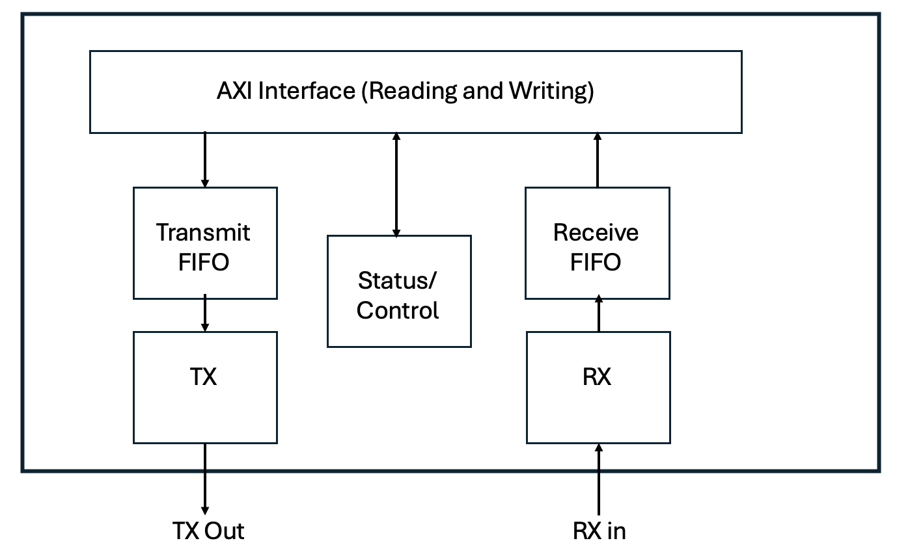

# AXI Bus Interface

In this assignment you will create an AXI4-Lite subordinate interface that connects to your UART transmitter and receiver modules from previous assignments.

The AXI specification calls the two sides of a bus transaction the **manager** (the side that starts transactions, such as a processor) and the **subordinate** (the side that responds to them, such as your UART).
Older versions of the specification, and many AMD tools and documents, use the terms **master** and **slave** for the same roles.
You will see both sets of terms: for example, the AXI VIP in your testbench is configured as a "master" and its signals are named `M_AXI_*`.

## FIFO

The AXI UART interface requires a FIFO to manage the flow of data between the AXI bus and the UART modules.
Start the assignment by creating a simple FIFO module named `fifo.sv`.
Design your fifo with the following parameters and ports:

| Parameter | Default | Purpose |
| ---- | ---- | ---- |
| DATA_WIDTH | 8 | Width of the data bus |
| DEPTH | 32 | Number of entries in the FIFO (must be a power of 2) |

| Port | Direction | Width | Purpose |
| ---- | ---- | ---- | ---- |
| clk | Input | 1 | Clock |
| rst | Input | 1 | Synchronous reset (active high): resets the pointers and the status signals |
| clr | Input | 1 | Synchronous clear (active high): same effect as `rst`, used to empty the FIFO without resetting the rest of the design |
| we | Input | 1 | Write enable: writes `din` into the FIFO on the rising clock edge |
| din | Input | DATA_WIDTH | Write data |
| re | Input | 1 | Read enable: removes the entry at the head of the FIFO on the rising clock edge |
| dout | Output | DATA_WIDTH | Read data: the entry at the head of the FIFO |
| full | Output | 1 | The FIFO is full and cannot accept more data |
| empty | Output | 1 | The FIFO is empty and there is no data to read |
| overflow | Output | 1 | A write was attempted when the FIFO was full |
| underflow | Output | 1 | A read was attempted when the FIFO was empty |

Note that `rst` and `clr` are active high, while the AXI reset (`s_axi_aresetn`) used later in this assignment is active low.
Your `uart_axi` module will need to invert the AXI reset before connecting it to the FIFO `rst` port.

Implement your FIFO as follows:
* Design your FIFO to take advantage of the "distributed RAM" feature of the FPGA (see the [Distributed RAM Examples](https://docs.amd.com/r/en-US/ug901-vivado-synthesis/Distributed-RAM-Examples) section of the synthesis guide).
  * Allocate an array of size DATA_WIDTH x DEPTH to implement the FIFO storage.
  * Writes to the array are synchronous to the clock.
  * Reads from the array are asynchronous (combinational). This is what allows the array to be mapped to distributed RAM (`RAM32M` or similar primitives with the default `DEPTH` of 32).
* Create a 'write pointer' that addresses the write port of the array and a 'read pointer' that addresses the read port.
  * Make each pointer one bit wider than needed to address the array ($clog2(DEPTH)+1 bits). Use the lower bits to address the array; the extra upper bit distinguishes full from empty.
  * `empty` is asserted when the two pointers are equal (all bits).
  * `full` is asserted when the lower bits of the pointers are equal and the upper bits differ. Your FIFO therefore holds exactly `DEPTH` entries.
  * Because the pointers roll over naturally, `DEPTH` must be a power of 2.
* Read behavior ("first-word fall-through"): `dout` always shows the entry at the read pointer, without waiting for a clock edge.
  Asserting `re` does not change `dout` in the same cycle; it advances the read pointer at the next rising clock edge so that `dout` then shows the next entry.
  This allows a circuit that uses the FIFO to look at `dout` and assert `re` in the same cycle to consume the entry.
  The value of `dout` is undefined when the FIFO is empty.
* Ignore writes when the FIFO is full and reads when the FIFO is empty (the pointers do not move).
  These decisions are based on the `full` and `empty` values at the start of the clock cycle. If `we` and `re` are asserted in the same cycle:
  * When the FIFO is neither empty nor full, both the write and the read occur (the number of entries does not change).
  * When the FIFO is empty, only the write occurs (and `underflow` is set).
  * When the FIFO is full, only the read occurs (and `overflow` is set).
* `overflow` and `underflow` are "sticky": once set, they stay set until `rst` or `clr` is asserted.

### FIFO Testbench

Create a testbench named `fifo_tb.sv` that instantiates your fifo and simulates the fifo.
The structure of this testbench is similar to the FIFO testbench you wrote for the bram assignment, so feel free to reuse code from it.
Note, however, that the two FIFOs behave differently: the bram FIFO has a one cycle read latency and no overflow/underflow signals, while this FIFO's `dout` shows the head entry immediately.
Include the following tests in your testbench:
* Write a few bytes of data and read them back out (without overflow or underflow). Check that the bytes read from `dout` match the bytes written.
* Write enough bytes to fill up the FIFO and verify that the full signal is asserted
* Attempt to write one more byte and verify that the overflow signal is asserted
* Read one byte and verify that `full` is deasserted. Read the rest of the bytes, checking each value, and verify that `empty` is asserted after the last read.
* Issue the 'clear' signal and verify that the fifo error is cleared.
* Attempt to read from an empty fifo and verify that the underflow signal is asserted
* Issue the 'clear' signal and verify that the fifo error is cleared.
* Write and read more than `DEPTH` bytes in total (for example, keep the FIFO partially full while writing and reading 3 x `DEPTH` bytes) to verify that the pointers wrap around correctly.
* Assert `we` and `re` in the same cycle when the FIFO is empty, when it is partially full, and when it is full, and verify the behavior described above.

Your testbench should be self-checking: count the number of errors and print `Simulation done with X errors` at the end of the simulation.
Create a makefile rule `sim_fifo` that performs this simulation from the command line and generates a log file named `sim_fifo.log`.

### FIFO Synthesis

Create a makefile rule named `synth_fifo` that synthesizes your fifo module and generates a synthesis log file named `synth_fifo.log`.
Review the synthesis report and verify that your fifo was implemented using distributed RAM (it must include one or more RAM32xxx primitives).

## AXI-Lite UART Interface

Create a new module named `uart_axi.sv` that implements an AXI4-Lite subordinate interface to your UART transmitter and receiver modules.
Base your new module on the module template file named `uart_axi_template.sv`.
This file includes the port definitions and parameters for your module to help you get started.
The following parameters are included:

| Parameter | Default | Purpose |
| ---- | ---- | ---- |
| CLK_FREQUENCY | 100_000_000 | Clock frequency in Hz (passed to your transmitter and receiver) |
| BAUD_RATE | 115_200 | Baud rate (passed to your transmitter and receiver) |
| PARITY | 1 | Parity type, 0 = even, 1 = odd (passed to your transmitter and receiver) |
| FIFO_DEPTH | 32 | Number of entries in each FIFO (passed to the `DEPTH` parameter of both FIFOs) |
| C_S_AXI_ADDR_WIDTH | 4 | Width of the AXI address bus |

A Verilog wrapper named `uart_axi_wrapper.v` is also provided for this assignment.
It instances your `uart_axi` module and passes through all of its parameters and ports.
You do not need it for this assignment, but you will use it in the MicroBlaze assignment.
Make sure your `uart_axi` module uses exactly the parameter and port names of the template so that the wrapper works without changes.

The general structure of your module is shown in the figure below.
Your module will instance your transmitter along with a FIFO to buffer data from the AXI interface to the FIFO.
An AXI write to the TX data register places a byte in the transmit FIFO, and the transmit logic sends bytes from this FIFO through your transmitter (this way you can write multiple bytes to the FIFO before the bytes have finished transmission).
Your module will also instance your receiver with a FIFO.
Bytes arriving on `rx_in` are received by your receiver and placed in the receive FIFO, and an AXI read of the RX data register removes a byte from this FIFO.
The FIFOs separate the AXI bus from the UART: an AXI transaction completes in a few clock cycles while a byte takes many microseconds to send or receive.
The UART side of each path operates independently of the AXI side. For example, the receiver writes bytes into the receive FIFO whenever they arrive, regardless of whether any AXI reads are taking place.



Follow the instructions below for building your AXI UART.

### Transmitter

Instance your transmitter module from the previous UART transmitter assignment using the parameters of this module.
Do not copy your transmitter file into this assignment directory.
Instead, reference it with a relative path to the earlier assignment directory (e.g., `../tx_sim/tx.sv`) in your makefile rules, as you did in the tx_download assignment.
If you need to fix a bug in the transmitter, make the change in the earlier directory (your original submission is preserved by its tag).
Instance your fifo module designed above for the transmit path. 
The input to the transmit FIFO comes from the AXI bus write data (discussed in more detail below).
The output of the transmit FIFO goes to your UART transmitter module.
Create the logic necessary to issues a transmit request to the UART transmitter when the transmit FIFO is not empty and the UART transmitter is not busy.
This logic should operate independently of the AXI bus.

The following signals for the transmitter will be hooked up to the AXI bus interface as described later in the instructions:

* The TX FIFO empty signal
* The TX FIFO full signal
* The TX FIFO overflow signal
* The transmitter busy signal
* The reset for the transmitter and the TX FIFO
* The interface for writing data into the TX FIFO

### Receiver

Instance your receiver module from the previous UART receiver assignment using the parameters of this module.
As with the transmitter, reference the receiver file with a relative path (e.g., `../rx_sim/rx.sv`) rather than copying it.
Instance another fifo module for the receiver path.
The input to the receiver FIFO comes from your UART receiver module.
The output of the receiver FIFO goes to the AXI bus read data (discussed in more detail below).
Create the logic necessary that writes a byte to the receiver FIFO whenever the UART receiver indicates that a byte has been received and the receive FIFO is not full.
This logic should operate independently of the AXI bus.

The following signals for the receiver will be hooked up to the AXI bus interface as described later in the instructions:

* The RX FIFO empty signal
* The RX FIFO full signal
* The RX FIFO underflow signal
* The receiver busy signal
* The reset for the receiver and the RX FIFO
* The interface for reading data from the RX FIFO

### AXI4-Lite Bus Interface

The primary effort invovled with this assignment is creating the AXI4-Lite interface to connect the UART transmitter and receiver to the AXI bus.
This interface will allow a manager on the AXI bus to read data from your UART (such as the data received over the serial line as well as UART status) and to write data to the UART (such as data to be transmitted over the serial line and set control registers).
Your AXI UART will have a base address in which all the registers are mapped and should support the following address map:

| Address Offset | Read | Write |
| ---- | ---- | ---- |
| 0x00 | RX Data | TX Data |
| 0x04 | Status Register (read only) | Control Register (write only) |
| 0x08, 0x0C | Reads return 0 | Writes are ignored |

For example, if the manager writes to the baseaddress+0x00, your module will write a byte to the transmit FIFO.
When reading from this same address, your module will return a byte from the receive FIFO.
If the manager writes to the baseaddress+0x04, your module will write a value to the control register (described below).
If the manager reads from the baseaddress+0x04, your module will return the value of the status register (described below).

<!-- * Reads to address offset 0x00 return a byte from the receiver FIFO. 
* Writes to address offset 0x00 write a byte to the transmit FIFO.
* Reads to address offset 0x04 return the value of status register (described below)
* Writes to address offset 0x04 write the value of the control register (described below) -->

**Address decode**

The `C_S_AXI_ADDR_WIDTH` of 4 gives four 32-bit registers at offsets 0x00, 0x04, 0x08, and 0x0C.
Decode the register using address bits [3:2] of the read or write address and ignore bits [1:0].
Offsets 0x08 and 0x0C are unused: reads return 0 and writes have no effect.

**Data width and responses**

* All data is 32 bits wide. A read of the RX data register returns the received byte in bits [7:0] with bits [31:8] set to 0.
* A write to the TX data register sends bits [7:0] of the write data to the transmit FIFO and ignores bits [31:8].
* Ignore `s_axi_wstrb`: every write is treated as a full 32-bit write.
* Always respond with `OKAY` (`2'b00`) on `s_axi_bresp` and `s_axi_rresp`, including for the unused offsets and for reads and writes that cause an underflow or overflow.
  Errors are reported through the status register rather than through the AXI response.

**Read and write side effects**

* A read of offset 0x00 removes exactly one byte from the receive FIFO.
  Do this when the read address handshake completes (`s_axi_arvalid` and `s_axi_arready` both high): capture the FIFO `dout` into your read data register and assert the FIFO `re` for that one cycle.
  Do not assert `re` again while you wait for `s_axi_rready`, or you will lose bytes.
* A read of offset 0x00 when the receive FIFO is empty returns 0.
  Assert `re` anyway so that the FIFO sets its underflow flag (RX underflow in the status register).
* A write to offset 0x00 asserts the transmit FIFO `we` for one cycle.
  If the transmit FIFO is full, the FIFO drops the byte and sets its overflow flag (TX overflow in the status register).
* Reads of the status register have no side effects.

To implement this functionaliy, your logic needs to implement the 'address read' channel to accept the address that the manager wants to read (so you can decide which data to return).
It also must implement the 'data read' channel to provide a response with the appropriate data (based on the address).
Your logic will also need to implement the 'address write' channel, 'data write' channel, and 'write response' channel.

For simplicity, create a single AXI state machine that implements the functionality of the five AXI channels.
Suggestions for this state machine are as follows:

* Have an idle state that is waiting for either a 'address read' or 'address write' sequence
* When an 'address read' occurs:
  * Capture the address that needs to be read and complete the 'address read' sequence
  * Obtain the data that is to be read (status or rx FIFO value)
  * Perform the 'data read' sequence to provide the appropriate data
* When an 'address write' occurs:
  * Capture the address that needs to be written and complete the 'address write' sequence
  * Capture the data that needs to be written and complete the 'data write' sequence (you could complete both sequences at the same time)
  * Write the data to the appropriate location (into the TX FIFO or the control register)
  * Perform the 'write response' sequence

Additional details on this interface are described below:

**Reset**

The AXI reset `s_axi_aresetn` is active low and synchronous to `s_axi_aclk`.
While it is low, your module must reset both FIFOs, the transmitter and receiver, the transmit and receive logic, and the AXI interface state.
In particular, `s_axi_bvalid` and `s_axi_rvalid` must be low during reset and must not be asserted until a transaction is received after reset.
Remember that your FIFO, transmitter, and receiver use active high resets, so invert `s_axi_aresetn` before connecting it to them.

**Status Register**

A status register must be included to allow the manager to read the status to indicate how to interact with the UART.
The status register must include each of the following bits and in the given location.
When an AXI read occurs at the status register, return the value of each of the following bits:


| Bit | Purpose |
| ---- | ---- |
| 0 | TX Busy (the transmitter is sending a byte) |
| 1 | RX Busy (the receiver is receiving a byte) |
| 2 | RX error status |
| 3 | TX FIFO full |
| 4 | RX FIFO empty |
| 5 | TX overflow |
| 6 | RX underflow |
| 7 | TX FIFO empty |
| 8 | RX FIFO full |

Bits that are not listed in the table read as 0.

* **TX Busy** is the `busy` output of your transmitter. It shows only whether the transmitter is sending a byte and ignores the transmit FIFO.
  Between bytes, TX Busy may be low while the transmit FIFO still holds data.
  Software that needs to know that all data has been sent should wait until TX FIFO empty is 1 and TX Busy is 0.
* **RX error status** is sticky: it is set when your receiver completes a byte with its `parityErr` output high, and it stays set until the RX FIFO is cleared (control register bit 1) or the module is reset.
* **TX overflow** and **RX underflow** are the sticky `overflow` and `underflow` outputs of the corresponding FIFOs.

**Control Register**

Create a control register to allow the manager to control the UART.

| Bit | Purpose |
| ---- | ---- |
| 0 | Clear TX FIFO |
| 1 | Clear RX FIFO |

* The clear bits are one-cycle pulses: writing a 1 to a bit asserts the `clr` input of that FIFO for one clock cycle. Writing a 0 has no effect.
  The control register does not hold its value, so the FIFOs are never held in the cleared state.
  This means that writing `0x3` clears both FIFOs, and there is no need to write `0x0` afterwards.
* Clearing a FIFO also clears its sticky flags: clearing the TX FIFO clears TX overflow, and clearing the RX FIFO clears RX underflow and RX error status.
* Clearing the TX FIFO does not stop a byte that the transmitter is already sending.
* The control register is write only: a read of offset 0x04 returns the status register.

**References**

* The AXI lecture notes: [AXI](../lectures/axi.md)
* The [AMBA AXI Protocol Specification](https://developer.arm.com/documentation/ihi0022/latest) (ARM IHI 0022), in particular the AXI4-Lite section
* The [Vivado Design Suite: AXI Reference Guide](https://docs.amd.com/v/u/en-US/ug1037-vivado-axi-reference-guide) (UG1037)

<!-- 
### Synthesis

After creating your AXI UART module, create a makefile rule named `synth_axi` that synthesizes your `uart_axi.sv` module and generates a synthesis log file named `synth_axi.log`.
Don't worry whether the implementation works at this point - the purpose of the synthesis is to verify that your design can be synthesized without errors. 
-->

## AXI UART Simulation

The next step in this assignment is to simulate the AXI UART interface.
You will need to create a testbench named `uart_axi_tb.sv` that instantiates your `uart_axi.sv` module and the AXI VIP.
To save you time, a template file that includes these instantiations is provided in a file named `uart_axi_tb_template.sv`.
<!-- We will be using the Xilinx AXI Bus Functional Model (BFM) called the "VIP" to simulate the AXI bus transactions. -->
The sections below will describe (1) how to generate/access the AXI VIP and (2) how to hook it up and use it in your testbench.

### AXI VIP

The Xilinx/AMD tools include a pre-built AXI4-Lite Bus Functional Model (BFM) called the "AXI VIP".
This VIP can be used to simulate AXI bus transactions in your testbench to make sure your AXI interface works correctly.
You will need to 'generate' this IP from the Vivado IP tool in order to access the source files for simulation.

A script named `create_vip_files.tcl` is provided in this assignment directory that will generate the AXI VIP files for you.
This script creates a new Vivado IP project and generates the VIP files you need to include in your simulation.
Create a makefile rule named `build_vip` that executes the following command to generate the VIP files and a log file named `build_vip.log`:
```
vivado -mode batch -source create_vip_files.tcl -log build_vip.log
```
This command will generate a directory named `ip` that contains the following AXI VIP source files you need for simulation:
  * `./ip/axi_vip_0/sim/axi_vip_0_pkg.sv`
  * `./ip/axi_vip_0/sim/axi_vip_0.sv`
Add this directory to your `.gitignore` file.
Your `clean` makefile rule should remove the `ip` directory along with the other generated files: the Questa `work` library, the `.Xil` directory, `*.jou` and `*.log` files, and any checkpoint (`.dcp`) files.


### Testbench

Copy the axi testbench template file `uart_axi_tb_template.sv` to `uart_axi_tb.sv` and create a testbench with the following steps:
* Instance a transmitter module into your testbench and attach its output to the input of your AXI UART module (`rx_in`). This transmitter is used in the testbench to send data to your AXI UART.
* Instance a receiver module into your testbench and attach its input to the output of your AXI UART module (`tx_out`). This receiver is used in the testbench to receive data from your AXI UART.
* Create a SystemVerilog 'queue' object that represents a queue of bytes that need to be transmitted by your testbench tx module to the receiver of your uart_axi module. Create logic within your testbench that will send a byte from this queue whenever the queue is not empty and the testbench transmitter is not busy. Print a message every time a new byte is sent.
* Add logic into your testbench that prints a message every time a new byte is received by your testbench rx module (i.e., sent by your uart_axi module).
* Add the following to your 'initial' block testbench procedure:
    * Create a clock running at 100 MHz
    * Issue the axi reset signal
    * Perform a read over the axi bus to read the status register (verify that the value is correct)
    * Send a few bytes to the uart_axi module over the axi bus to be transmitted by your module
    * Read the status register to make sure the tx FIFO is not empty
    * Add a few bytes to the transmit queue to be sent by the transmitter module
    * Wait for these bytes to be transferred to your module
    * Read the status register to make sure the rx FIFO is not empty
    * Perform a few reads over the axi bus to read the received bytes from the receiver fifo.
    * Perform a write to the control register to reset the internal FIFOs.

Simulating the VIP requires two precompiled libraries that are provided with Vivado:
* `xilinx_vip` contains the `axi_vip_pkg` package (imported at the top of the testbench template) that defines the VIP agent classes and the transaction functions such as `AXI4LITE_WRITE_BURST`.
* `axi_vip_v1_1_17` contains the VIP module itself, which is instanced by the generated `axi_vip_0.sv` wrapper. The version number in this name changes with the Vivado version, so check the `data/questa` directory of your Vivado installation if this library is not found.

To simulate your testbench and the VIP files, you will need to compile the files in modelsim as follows:
  * Compile the `axi_vip_0_pkg.sv` file generated by the `build_vip` rule using the `-L xilinx_vip` flag: `vlog -sv -L xilinx_vip ./ip/axi_vip_0/sim/axi_vip_0_pkg.sv`
  * Compile the `axi_vip_0.sv` file generated by the `build_vip` rule using the `-L xilinx_vip` flag: `vlog -sv -L xilinx_vip ./ip/axi_vip_0/sim/axi_vip_0.sv`
  * Add the `-L xilinx_vip` flag when running `vlog` on your testbench
  * Add the following libraries when you run the `vsim` commnad: `-L xilinx_vip` and `-L axi_vip_v1_1_17`
  * Add the following lines to your modelsim.ini

```
axi_vip_v1_1_17 = /tools/Xilinx/Vivado/2024.1/data/questa/axi_vip_v1_1_17
xilinx_vip = /tools/Xilinx/Vivado/2024.1/data/questa/xilinx_vip
```

Create a makefile rule `sim_uart_axi` that performs this simulation from the command line and generates a log file named `sim_uart_axi.log`.
Make sure you have messages in your simulation output that indicate each of the steps described above.

The AXI VIP includes a protocol checker that monitors every transaction and reports violations of the AXI rules (for example, a `VALID` signal that is deasserted before its handshake completes).
These violations are printed as errors or warnings in the simulation log, with a message identifying the rule that was broken.
Search `sim_uart_axi.log` for VIP errors and warnings after every simulation and fix all of them: this is the fastest way to find handshake bugs in your design.

Take a screenshot of the simulation waveform that shows one AXI write and one AXI read to your `uart_axi` module.
Include the `VALID`, `READY`, address, and data signals of each channel used by the transaction, and zoom in so that the individual handshakes are visible.
Save the screenshot as `uart_axi_sim.png` and commit it to your repository.

## AXI UART Synthesis

Once your AXI UART IP is simulating properly, synthesize the module to resolve any synthesis errors.
It is important to make sure that it is synthesizable before trying to integrate it in a future project.

Create a makefile rule named `synth_uart_axi` that synthesizes your module and generates a synthesis log file named `synth_uart_axi.log`.
Review the synthesis report to identify any potential problems.

## Submission and Grading

1. Implement all the required makefile rules and make sure your `passoff.py` script runs without errors.
2. Complete and commit the [report.md](report.md) file for this assignment.

You must follow the [Level 3](../resources/coding_standard.md#level-3) coding standards for your SystemVerilog files.

<!--
- A diagram or something to refer to in the instructions. The one in class helped to grasp it better.  (the diagram could show the axi bus interface, the FIOs and the Rx/RX like I did in class.)
- Make the report more interesting and involved
- Clarify the process for simulating
- A step-by-step description of one of the AXI-UART transactions would have helped me get started much more easily. I understand we talked about it the structure and broadly described what we wanted in class, and I took notes on what was discussed. However, without a resource I could trust to be accurate I spent a lot of time writing something that was incorrect. For example, it was unclear that writing to the RX FIFO over UART and reading from AXI were meant to operate independently, so I assumed that it was one transaction. A detailed explanation of the process would have helped me avoid that pitfall.
-->