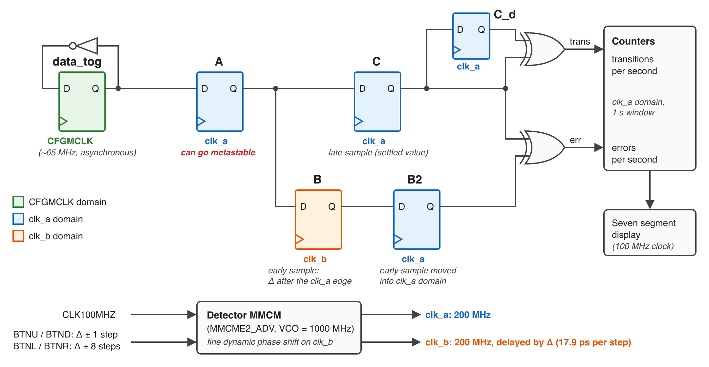

# MMCM Assignment

In this assignment you will learn how to use the MMCM primitive to create a deskewed clock and clocks of various frequency and phase.
You will also build and run a provided design that measures metastability in a flip-flop.
You will use the switches, buttons, seven segment display, and LEDs to interact with your clocking circuit.

##  Top-Level Design

This assignment will involve the creation of a single top-level design.
Create your top-level design with the name `mmcm_top.sv` and with the following ports and parameters.

| Port Name | Direction | Width | Function |
| ---- | ---- | ---- | ----  |
| CLK100MHZ | Input | 1 | Clock |
| CPU_RESETN | Input | 1 | Reset (low asserted) |
| SW | Input | 4 | Switches (Determine which counter to display) |
| LED | Output | 4 | Board LEDs (display the switches) |
| AN | Output | 8 | Anode signals for the seven segment display |
| CA, CB, CC, CD, CE, CF, CG | Output | 1 each | Seven segment display cathode signals |
| DP | Output | 1 | Seven segment display digit point signal |

| Parameter Name | Default Value | Purpose |
| ---- | ---- | ---- |
| CLK_FREQUENCY  | 100_000_000 | Specify the clock frequency |
| REFRESH_RATE  | 200 | Specifies the display refresh rate in Hz of the seven segment display (passed to your `seven_segment8` module) |

###  Main MMCM

The first step in this assignment is to create your "Main" MMCM that is used to deskew the input clock and generate a variety of clocks.
The details of the MMCM and its configurations are described in the [7 Series FPGAs Clocking Resources User Guide (UG472)](https://docs.amd.com/v/u/en-US/ug472_7Series_Clocking).
The figure numbers referenced below are from version 1.14 of this guide.

The following clock names are used throughout this assignment:
  * **Input clock**: the free-running 100 MHz board clock that comes into the FPGA on the `CLK100MHZ` pin
  * **CLKOUT0** through **CLKOUT6**: the clocks generated by the main MMCM
  * **CLKB**: the clock generated by the secondary MMCM (described below)

Instance the "MMCME2_BASE" primitive into your design and hook it up as described below. 
You can learn more about primitives that can be instantiated at the following [library guide (UG953)](https://docs.amd.com/r/en-US/ug953-vivado-7series-libraries). 
Note that you can look at the text for the module definition of this primitive in the following file: `<Xilinx>/Vivado/<version>/data/verilog/src/unisim_comp.v`

  * Use the board RST to reset this MMCM
    * Although the reset button signal doesn't really need to be synchronized for this situation, it is a good idea to add a synchronizer to clean up the signal a bit (avoid lots of high frequency glitches). These synchronizers should be clocked by the input clock (not any of the generated clocks from the MMCM).
  * Configure the MMCM and instance BUFGs so that the MMCM performs a "deskew" function (UG472, Figure 3-11) on the input clock. The CLKOUT0 should be in phase with the input clock and have a 50% duty cycle
  * Make sure all inputs to the MMCM have a value (use a constant if it is not used)
  * Create additional clock outputs with the following requirements:
    * CLKOUT1: Same clock frequency as input, phase shifted 180 degrees, 25% duty cycle
    * CLKOUT2: Same clock frequency as input, phase shifted 90 degrees, 75% duty cycle
    * CLKOUT3: Lower clock frequency than input, out of phase with input (any non-zero phase shift is acceptable). Do not use power of 2 divide and make this at least 6x lower frequency than the input.
    * CLKOUT4: Higher clock frequency than input, out of phase with input (any non-zero phase shift is acceptable). Do not use power of 2 multiply and make this at least 2.1x greater than the input clock (i.e., at least 210 MHz).
    * CLKOUT5: Lower clock frequency than input (but different from CLKOUT3), in phase with input
    * CLKOUT6: Higher clock frequency than input (but different from CLKOUT4), in phase with input

All of these clocks are generated from a single voltage controlled oscillator (VCO) within the MMCM, so you must choose the multiply value M (`CLKFBOUT_MULT_F`), the divide value D (`DIVCLK_DIVIDE`), and the output divide values (`CLKOUTn_DIVIDE`) so that every clock requirement is met by the same VCO frequency.
The VCO frequency and each output frequency are computed as follows:

  * F<sub>VCO</sub> = F<sub>in</sub> x M / D
  * F<sub>CLKOUTn</sub> = F<sub>VCO</sub> / CLKOUTn_DIVIDE

The following constraints apply to the `xc7a100tcsg324-1` part used in this class (see the MMCM switching characteristics in the [Artix-7 Data Sheet (DS181)](https://docs.amd.com/v/u/en-US/ds181_Artix_7_Data_Sheet)):
  * The VCO frequency must be between 600 MHz and 1200 MHz (the 1200 MHz maximum is the limit for the -1 speed grade; faster speed grades allow higher frequencies). With a 100 MHz input clock, M/D must be between 6 and 12.
  * The phase detector input frequency (F<sub>in</sub> / D) must be at least 10 MHz. With a 100 MHz input clock, D can be no larger than 10.
  * Since CLKOUT0, CLKOUT1, and CLKOUT2 must all be 100 MHz, the VCO frequency must be an integer multiple of 100 MHz (i.e., 600, 700, ..., 1200 MHz). Only CLKOUT0 supports a fractional divide, so CLKOUT1 and CLKOUT2 need an integer divide of the VCO to reach 100 MHz. Starting with a VCO frequency that is a multiple of 100 MHz will save you a lot of trial and error.

Note that it may be difficult to meet timing on this part with the CLKOUT4 counter at 250 MHz or higher (although it has been done).
Choosing a CLKOUT4 frequency closer to the 210 MHz minimum will make timing closure easier.

### Clock Domain Reset signals

You will need to create a separate reset signal for each of the clock domains you created.
This reset signal will be used by the logic in each of the clock domains. 
The purpose of this reset signal is to provide a power up reset that is synchronous with the given clock domain.

A good example on how to do this is shown [here](./mmcm_reset.png) 
(this image is Figure 4 of the following [URL](http://www.markharvey.info/art/7clk_19.10.2015/7clk_19.10.2015.html)).
This approach involves the following principles:
  * Provide several flip-flops in a chain for the reset signal (at least two as a synchronizer and a few more if you want more time for the reset)
  * The last flip-flop of this chain is your clock domain reset signal, the first flip-flop should have a '0' as its input (so that the 0 can propagate through the flip-flop chain)
  * These flip-flops should be asynchronously "Preset" when the `LOCKED` signal of the MMCM that generates the clock domain is low. This way, the reset signal going to the clock domain will be asserted immediately when `LOCKED` goes low (i.e., when you lose a good clock)
    * Use the main MMCM's `LOCKED` for the CLKOUT0 through CLKOUT6 domains, and the secondary MMCM's `LOCKED` for the CLKB domain.
  * These flip-flops should be clocked by clock signal generated by the MMCM that corresponds to the clock domain of interest.

### Clock Domain Counters

Create 48-bit counters for each of the 7 clock domains. 
Each of these counters should be reset using the appropriate reset circuit created above. 
These counters will be referred to later in the description as CNT0, CNT1, ... CNT6.

### Clock Domain Crossing Signals

For this part you will create enable signals in various clock domains and "count" these enable pulses in a different clock domain. 

  * Create a single pulse in the CLKOUT3 domain (≤ 16.7 MHz, since CLKOUT3 is at least 6x slower than the input clock) that is asserted for one clock cycle every 4 clock cycles (PULSE3). Make sure this pulse is glitch free.
  * Create a single pulse in the CLKOUT4 domain (≥ 210 MHz) that is asserted for one clock cycle every 100 clock cycles (PULSE4). Make sure this pulse is glitch free.
  * Create a 32-bit counter in the CLKOUT0 domain that counts the PULSE3 pulses (generated by the CLKOUT3 domain). Note that you should only count once for each unique PULSE3 signal. Since CLKOUT3 is much slower than CLKOUT0, each PULSE3 pulse will be high for several CLKOUT0 cycles. Pass PULSE3 through a synchronizer in the CLKOUT0 domain and then use a rising edge detector on the synchronized signal so that each PULSE3 pulse is counted exactly once. This counter will be referred to as PULSE3CNT.
  * Create a 32-bit counter in the CLKOUT0 domain that counts the PULSE4 pulses. Note that you should only count once for each unique PULSE4 signal. Further, you need to make sure you do not miss any PULSE4 signals (since the PULSE4 signals are shorter than a clock cycle in the CLKOUT0 domain). Consider using a pulse stretcher circuit or a toggle (non-return-to-zero) synchronizer. This counter will be referred to as PULSE4CNT.

When synchronizing the pulse signal that crosses clock domains, you will want to use the `ASYNC_REG` attribute to instruct the synthesis tool that these signals are asynchronous.
This attribute specifies that (1) a register can receive asynchronous data on the D input pin relative to its source clock and (2) a register is a synchronizing register within a synchronization chain.
From the [ASYNC_REG section of the Vivado Synthesis Guide (UG901)](https://docs.amd.com/r/en-US/ug901-vivado-synthesis/ASYNC_REG):
> Specifying ASYNC_REG also affects optimization, placement, and routing to improve mean time between failure (MTBF) for registers that can go metastable. If ASYNC_REG is applied, the placer will ensure the flip-flops on a synchronization chain are placed closely together to maximize MTBF. Registers that have this property that are directly connected will be grouped and placed together into a single SLICE/CLB, assuming they have a compatible control set and the number of registers does not exceed the available resources of the SLICE/CLB.

```
    (* ASYNC_REG = "TRUE" *) logic pulse3_clk0_d, pulse3_clk0_dd, pulse3_clk0_ddd;
```

### Secondary MMCM

Instance a second MMCM that uses CLKOUT0 as its input clock. 
Create a new clock, CLKB, from this MMCM that is a fractional value of the frequency of CLKOUT0 (using prime numbers for M and D). 
Your resulting frequency should be between 50 MHz and 100 MHz. 
The same VCO constraints described for the main MMCM apply here: with CLKOUT0 (100 MHz) as the input, M/D must be between 6 and 12, and the phase detector input frequency (100 MHz / D) must be at least 10 MHz, so D must be a prime number no larger than 10 (i.e., 2, 3, 5, or 7).
Do **NOT** use deskewing in this configuration (i.e., do not align CLKB with CLKOUT0 - see UG472, Figure 3-13). 
Instead, use internal feedback: connect the `CLKFBOUT` output of this MMCM directly to its `CLKFBIN` input (without a BUFG). 
The goal here is to make a second MMCM that is *not* necessarily synchronous with CLKOUT0 (in most cases you would just make them synchronous).
This MMCM should be reset when the first MMCM is not locked (i.e., the output of the first locked signal should drive the input of the second reset with an inverter so that the second MMCM doesn't start to operate until the first one has locked).
Create a 48-bit counter in the CLKB clock domain named CNTB_0. 
This counter should be reset using an appropriate reset signal (i.e., a reset signal that is synchronous with the CLKB clock domain).

<!-- 
This portion of the lab is moved to a standalone design that the students will run.

### Metastability Circuit

Create a signal in the CLKB clock domain that toggles every clock cycle. 
This signal will be the "input" signal used for inducing metastability. 
Create a metastability detection circuit (see resources below) 
  * [Old FPGA app note: Figure 1](https://docs.xilinx.com/v/u/en-US/xapp094)
  * [this paper](https://www.researchgate.net/publication/258377930_Metastability_Testing_at_FPGA_Circuit_Design_using_Propagation_Time_Characterization)
  * (Let me know if you find some other good ones!)
(as shown [here in Figure 1](http://userweb.eng.gla.ac.uk/scott.roy/DCD3/technotes.pdf).)
The f_data signal is your toggling circuit created in the CLKB clock domain. 
Use CLKOUT4 as the f_clk. 
Every time FF 'D' goes high, a metastability event has been detected.
Create a 32-bit counter in the CLKOUT4 clock domain that counts metastability events. 
This counter will be referred to as CNT_META. 
-->

### Seven Segment Display

Instance the seven segment display in your design. 
Note that you should drive the seven segment display with the input clock (`CLK100MHZ`). 
If you use a clock generated by one of the MMCMs then your seven segment display will be disabled when you press the reset button. 
Make sure that your seven segment display does NOT display the digit points.
Also, make sure the seven segment display still displays when the reset button is pressed (it should not blank during the reset process).
To do this, the seven segment display (and the mux register described below) should **not** use `CPU_RESETN` as its reset.
Instead, create a startup reset in the input clock domain that is asserted for a few clock cycles after the FPGA is configured and then stays deasserted.
For example, use a short chain of flip-flops with initial values of '1' (e.g., `logic [3:0] startup_rst_sr = 4'b1111;`) that shifts in '0' every clock cycle and use the last flip-flop as the reset.
The FPGA loads these initial values when it is configured, so the display is reset once at startup and never reset again.

Create a mux that selects one of the counters you generated based on the value of the switches. 
The switches are asynchronous inputs, so pass them through a two flip-flop synchronizer clocked by the input clock before using them as the mux select (and to drive the LEDs).
Note that for the 48-bit counters, display only the top 32 bits of the counter.
Place a register after this mux to synchronize the various counters in their different clock domains to the input clock (i.e., the same clock used by the seven segment display). 
You don't need two levels of synchronizers - just one to prepare the data for the seven segment display controller. 
It is possible you will get metastability, but this is not an issue for the seven segment display controller - you will never see it.

| SW[3:0]  | Display  |
| --- | --- |
| 0x0 | CNT0[47:16] |
| 0x1 | CNT1[47:16]  |
| 0x2 | CNT2[47:16]  |
| 0x3 | CNT3[47:16]  |
| 0x4 | CNT4[47:16]  |
| 0x5 | CNT5[47:16]  |
| 0x6 | CNT6[47:16]  |
| 0x7 | PULSE3CNT |
| 0x8 | PULSE4CNT |
| 0x9 | CNTB_0[47:16]  |
| 0xA - 0xF | 0 |

### Timing Constraints

In addition to the `(* ASYNC_REG = "TRUE" *)` attribute that you add to your HDL, you will need to add timing constraints for every clock domain crossing in this design.

Every clock in this design is derived from the input clock (all of the MMCM outputs come from the same VCO, and the secondary MMCM uses CLKOUT0 as its input).
As a result, Vivado treats every pair of clocks as *related* and times each clock domain crossing as if it were an ordinary synchronous path.
For each crossing, Vivado lines up the two clock waveforms over their common period and uses the closest pair of launch and capture edges as the timing requirement.
For clocks with unusual frequency ratios or phase shifts this requirement can be extremely small (e.g., about 0.3 ns for a crossing from CLKB to CLKOUT0), and the path will fail timing.
This requirement is meaningless for a synchronizer: the synchronizer is designed to tolerate data that arrives at *any* time relative to the capture clock.
Note that the `ASYNC_REG` attribute does not change the timing analysis (it only affects placement, optimization, and clock domain crossing reports).

For each clock domain crossing, add a `set_max_delay -datapath_only` constraint to your .xdc file:
```
set_max_delay -datapath_only <X> -from <source cells> -to <destination cells>
```
This constraint replaces the clock-edge based timing requirement with a simple rule: the data must travel from the source flip-flop to the destination flip-flop within `X` ns.
Specifically, the `-datapath_only` option:
* Ignores the clock latency (skew) of both clocks, which is meaningless between clocks that are treated as asynchronous
* Checks only the data path delay (clock-to-Q of the source flip-flop + logic + routing + setup time of the destination flip-flop) against `X`
* Removes the hold check on the path (a hold check on an asynchronous crossing is also meaningless)

You may have seen the `set_false_path` constraint used for this purpose.
A false path tells the tool to ignore the path completely, so the tool will accept any routing delay (even a very long one).
The `set_max_delay -datapath_only` constraint still times the path, so the crossing is routed with a bounded and predictable delay, and the tool will report a failure if the route is too long.
For clock domain crossings, `set_max_delay -datapath_only` is almost always what you want.

The following clock domain crossings in your design need this constraint:
* The first synchronizer flip-flop for the PULSE3 signal (CLKOUT3 to CLKOUT0)
* The first synchronizer flip-flop for the PULSE4 signal (CLKOUT4 to CLKOUT0)
* The register that samples the various counters for the seven-segment display (each counter's clock domain to the input clock domain)

Choose the value of `X` based on the type of crossing:

| Crossing | Value of `X` | Reason |
| ---- | ---- | ---- |
| Single-bit synchronizer (PULSE3, PULSE4) | The smaller of the source and destination clock periods | Keeps the crossing latency predictable |
| Counters to the seven-segment display register | One input clock period (10 ns) | Keeps the path constrained and short |

Compute these values from the clock frequencies you chose for your design.
The exact value is not critical (typical routes are 1-2 ns), but it should be a reasonable bound rather than a very large number.

The following example demonstrates these constraints (this example assumes CLKOUT4 is 220 MHz; use your own clock periods and cell names):
```
# Note that Vivado adds "_reg" to the name of each register in your HDL

# Counters in each clock domain to the seven-segment display register (input clock domain).
# A single constraint can list all of the counter registers.
set_max_delay -datapath_only 10.0 \
  -from [get_cells {clk0_cntr_reg[*] clk1_cntr_reg[*] clk2_cntr_reg[*] clk3_cntr_reg[*] \
                    clk4_cntr_reg[*] clk5_cntr_reg[*] clk6_cntr_reg[*] cntb_0_reg[*] \
                    pulse3cnt_reg[*] pulse4cnt_reg[*]}] \
  -to   [get_cells ssd_sync_reg[*]]

# PULSE3 (CLKOUT3) to the first synchronizer flip-flop (CLKOUT0): one CLKOUT0 period
set_max_delay -datapath_only 10.0 -from [get_cells pulse3_reg] -to [get_cells pulse3_clk0_d_reg]

# PULSE4 (CLKOUT4) to the first synchronizer flip-flop (CLKOUT0): one CLKOUT4 period
set_max_delay -datapath_only 4.5 -from [get_cells pulse4_toggle_reg] -to [get_cells pulse4_clk0_d_reg]

```

If your registers are inside a submodule, use the hierarchical name of the cell (e.g., `ssd_inst/ssd_sync_reg[*]`) or use `get_cells -hierarchical`.

After implementing your design, use the following commands to check your constraints:
* `report_exceptions -ignored`: Lists any constraints that did not match any cells or were overridden. A misspelled cell name will appear here (otherwise the constraint is silently ignored).
* `report_clock_interaction`: Shows how each pair of clocks is timed. Any pair still marked "Timed (unsafe)" has a clock domain crossing that you have not constrained.
* `report_timing_summary`: The "Inter-Clock Paths" section should show that all of the clock domain crossings meet timing.

### Clock Domain Crossing Report and Waivers

The timing constraints above make sure each clock domain crossing is routed with a bounded delay, but they do not check whether the crossing is *structurally* safe (i.e., whether it has a proper synchronizer).
Vivado provides the `report_cdc` command to check the structure of every clock domain crossing in your design:
```
report_cdc -details -file cdc_mmcm_top.rpt
```
The summary table at the top of this report lists each pair of clocks with the number of endpoints that are "Safe", "Unsafe", or "Unknown" and the number of synchronizers missing the `ASYNC_REG` attribute.
The details section lists each violation with a rule ID (e.g., `CDC-1`) and the source and destination cells.
Review this report and make sure each crossing is reported as expected:
* **PULSE3 and PULSE4 synchronizers**: These should be reported as "Safe" with no missing `ASYNC_REG`. If they are reported as "Unknown" or are missing `ASYNC_REG`, fix your synchronizer (do not waive these).
* **Synchronizers on the input ports** (switches and reset): These should also be "Safe" with no missing `ASYNC_REG`. Fix them if they are not.
* **Counters to the seven-segment display register**: These will be reported as "Unknown" with a *Critical* severity (rule `CDC-1`, "1-bit unknown CDC circuitry", for each bit of the display register) because each counter is sampled by a single register with no synchronizer. This crossing is unsafe on purpose: the value is only used for display and an incorrect sample lasts for only one display refresh. Add a waiver for this crossing.
* Every crossing you created should appear in this report. If one is missing, check that the signal crossing the clock domain is not used as a clock or latch enable (the report only analyzes data paths).

A waiver tells Vivado that you have reviewed a specific violation and have determined that it is acceptable.
Unlike `set_false_path`, a waiver does not change the timing analysis; it only marks the violation as reviewed in the CDC report.
Waived violations are still listed in the report as waived, so the decision is documented rather than hidden.
Add waivers with the `create_waiver` command in your .xdc file.
Each waiver must include the rule ID from the details section of your CDC report, your name (`-user`), and a description that explains why the crossing is acceptable.
Only waive the intentionally unsafe display crossing described above.

The following example demonstrates this waiver (use the rule ID and cell names from your own CDC report):
```
# Counters sampled by the seven-segment display register (input clock domain).
# A single waiver covers all of the counters since it only specifies the destination.
create_waiver -type CDC -id {CDC-1} -user "your_name" \
  -to [get_pins ssd_sync_reg[*]/D] \
  -description "Counters sampled for display only; an incorrect sample lasts one display refresh"

```

Create the report `cdc_mmcm_top.rpt` using the `report_cdc` command as part of your implementation script.

<!-- After adding the waivers, run `report_cdc` again and confirm that:
* The only remaining violations are waived (no unwaived *Critical* entries)
* No synchronizer is missing the `ASYNC_REG` attribute -->

You can use the `report_waivers` command to list all of the waivers in your design.

## Testbench

Create a top-level testbench named `mmcm_top_tb.sv` that simulates your design.
This testbench should demonstrate your clocking, counter circuits, seven segment display and mux are all working properly. 
This testbench is relatively simple and should just issue a reset signal, wait for the MMCMs to lock, and run for long enough to demonstrate the proper operation of all the clocks and counters.
Create a makefile rule `sim_mmcm_top` that performs this simulation from the command line and generates a log file named `sim_mmcm_top.log`.

Add a timescale directive to your testbench as follows (you will need pico-second resolution for this simulation):
```
`timescale 1ns / 1ps
```

Run your simulation in the GUI mode and create a waveform that demonstrates the proper operation of each of your 7 clocks.
Create a waveform that includes each of the seven clocks (mmcm_clk0, mmcm_clk1, ..., mmcm_clk6).
Use markers to measure the frequency/period, the phase offset, and the duty cycle of each clock.
Take a screenshot of this waveform that includes all the clocks and name the file `mmcm_waveform.png`.

## Implementation

### Synthesis

TODO: Have the students run the `report_cdc` command to check for any clock domain crossing issues in their design.
Done after the `check_timing` command.

`report_cdc -details -file cdc_report.rpt
`

Create a constraints file with all the necessary constraints for your design.
Make sure your constraints file includes the clock domain crossing constraints described in the [Timing Constraints](#timing-constraints) section above (as well as the false path constraints for the I/O pins that you added in the spi_download assignment).
Create a makefile rule named `synth_mmcm_top` that synthesizes your top-level design using the default parameters.
This makefile rule should generate a log file named `synth_mmcm_top.log` and a .dcp file named `mmcm_top_synth.dcp`.
Make sure all synthesis warnings and errors are resolved before proceeding with the implementation of your design.
Carefully track the number of times you synthesize your design to complete this assignment as this number will be required in the report section of this assignment.

**Make sure** the synthesis log shows that two MMCM primitives were allocated for your module.
Note that Vivado implements each `MMCME2_BASE` primitive as an `MMCME2_ADV` primitive, so look for two `MMCME2_ADV` cells in the synthesis log (and later in the utilization report).
If you do not have 2 MMCMs then your design will not work, and you should not proceed with the further steps.

### Placement, Routing, and Bitstream Generation

Create makefile rule named `implement_mmcm_top` that performs the placement, routing, report, bitstream, and dcp file generation.
It should use the `mmcm_top_synth.dcp` file as input.
This makefile rule should generate a log file named `implement_mmcm_top.log`, a .dcp file named `mmcm_top.dcp`, and a bitfile named `mmcm_top.bit`.
Generate a timing report file named `timing_mmcm_top.rpt` and a utilization report file named `utilization_mmcm_top.rpt`.

After successfully implementing your design, open your design in the Vivado GUI to see the layout of your design on the FPGA device.
Locate the two different MMCMs used by your design and determine the "Site" of each of the MMCMs (this will be something like `MMCME2_ADV_X#Y#`, where each `#` is a number, e.g., `MMCME2_ADV_X1Y2`). 
You will need to indicate the location in your report.

Make sure your design meets the timing constraint and doesn't have any errors or warnings.
Download your design and make sure it operates as expected.

## Metastability Circuit

In this part of the assignment you will build and run a provided design that measures metastability in a flip-flop of the FPGA.
This design is separate from your `mmcm_top` design: you do not need to add anything to your own design.

### How the circuit works

A flip-flop goes metastable when its data input changes very close to its clock edge.
When this happens, the output of the flip-flop takes longer than normal to settle to a '0' or '1'.
The time needed to settle is random, and the probability that the flip-flop has *not* settled after a time *t* drops exponentially (proportional to e<sup>-t/τ</sup>, where τ is the settling time constant of the flip-flop).
The flip-flops in this FPGA settle very quickly (τ is on the order of tens of picoseconds), so a flip-flop that is given a full clock period to settle will essentially never be caught in a metastable state.
To observe metastability, the output of the flip-flop must be checked only a few hundred picoseconds after the clock edge.

The provided design, [`metastability_top.sv`](metastability_top.sv), does this with the following circuit:
* **Asynchronous data**: A flip-flop toggles every cycle of `CFGMCLK`, the internal configuration oscillator of the FPGA (nominally 65 MHz). This oscillator is completely independent of the 100 MHz board clock, so the data changes at random times relative to the sampling clock. The `STARTUPE2` primitive provides access to this clock.
* **Sampling flip-flop (A)**: Samples the toggling data with `clk_a` (200 MHz). This is the flip-flop that can go metastable.
* **Early sample (B)**: Samples the output of A with `clk_b`, a copy of `clk_a` that is delayed by a small, adjustable time *delta*. If A has not settled within *delta* of the clock edge, B captures the wrong value.
* **Late sample (C)**: Samples the output of A one full `clk_a` period later. By this time A has settled, so C holds the correct value.
* **Error detection**: Flip-flop B2 moves the early sample into the `clk_a` domain so it can be compared with the late sample (both refer to the same `clk_a` edge). Each mismatch is an *error* (A had not settled within *delta*). Flip-flop C_d holds the previous late sample, and each change in the late sample is a *transition* of A.


<!-- The figure source is metastability_circuit.svg. After editing the SVG, regenerate the PNG (2x scale) from the mmcm directory with:
     rsvg-convert -z 2 -o metastability_circuit.png metastability_circuit.svg
     (rsvg-convert is part of librsvg: "brew install librsvg" on macOS, "apt install librsvg2-bin" on Ubuntu) -->

An MMCM generates `clk_a` and `clk_b`.
The delay *delta* is adjusted using the MMCM "fine dynamic phase shift" feature, which shifts `clk_b` by 1/56 of the MMCM VCO period for each step (about 17.9 ps with the 1000 MHz VCO used in this design).
The design counts errors and transitions for one second and displays the counts on the seven segment display.

### Building the design

The following files are provided in this directory:
* [`metastability_top.sv`](metastability_top.sv): the top-level design
* [`metastability_top.xdc`](metastability_top.xdc): the constraints for the design
* [`metastability_build.tcl`](metastability_build.tcl): a Vivado script that synthesizes and implements the design, generates reports, and generates the bitfile `metastability_top.bit`

The design uses your `seven_segment8` module (rx_sim assignment) and your `debounce` module (tx_download assignment).
The build script expects these modules in `../rx_sim/seven_segment8.sv` and `../tx_download/debounce.sv`.
If your files are in a different location, change the paths at the top of `metastability_build.tcl` (do not modify the other provided files).

Create a makefile rule named `build_metastability` that builds the design with the following command:
```
vivado -mode batch -source metastability_build.tcl -log metastability_build.log
```
This rule generates the following reports: `timing_metastability_top.rpt`, `utilization_metastability_top.rpt`, `clock_interaction_metastability_top.rpt`, and `cdc_metastability_top.rpt`.
Review the constraints file and these reports to see how the timing of the intentionally unsafe clock domain crossings in this circuit is constrained.

### Running the design

Download `metastability_top.bit` to your board.
The design is controlled with the buttons and switches as follows:

| Control | Function |
| ---- | ---- |
| BTNU / BTND | Increase / decrease *delta* by one step (about 17.9 ps) |
| BTNL / BTNR | Increase / decrease *delta* by eight steps (about 143 ps) |
| CPU_RESETN | Reset the design (*delta* returns to zero) |
| SW[1:0] = 00 | Display the number of errors in the last measurement |
| SW[1:0] = 01 | Display the number of transitions in the last measurement (frequency of the clock) |
| SW[1:0] = 10 | Display *delta*: the number of steps in the left four digits and the delay in ps in the right four digits |
| SW[1:0] = 11 | Display the number of measurements since reset |
| SW[2] | 0 = decimal display, 1 = hexadecimal display |

*Delta* is limited to the range of 0 to 140 steps (0 to 2.5 ns).
In decimal mode, the leftmost digit point indicates that the value is too large to display (larger than 99,999,999).

The LEDs show the status of the experiment:

| LED | Meaning |
| ---- | ---- |
| LED[0] | The MMCM is locked |
| LED[1] | The measurement is valid: a full one second measurement has completed since *delta* last changed |
| LED[2] | Toggles each time a new measurement is available (once per second) |
| LED[3] | *Delta* is at its minimum or maximum value |

A new measurement is available once per second.
The measurement that is in progress when you change *delta* includes samples from both the old and the new *delta*, so **always wait for LED[1] to turn on before recording a value** after changing *delta*.

### Exercises

Answer the questions for these exercises in your [report](report.md).
In these exercises, the *error ratio* is the number of errors divided by the number of transitions in a measurement.

1. **Review the reports.** Open `timing_metastability_top.rpt` and `cdc_metastability_top.rpt`.
   * Does the design meet timing?
   * Open `metastability_top.dcp` in Vivado and run `report_timing -from [get_cells ff_a_reg] -to [get_cells ff_b_reg]`. What is the data path delay from flip-flop A to flip-flop B? This is the normal (non-metastable) delay from the A clock edge to the B input.
   * Which clock domain crossings are waived in the CDC report, and why is it acceptable to waive them in this design?
2. **Measure the CFGMCLK frequency.** The data toggles on every `CFGMCLK` edge, so the number of transitions in one second is the frequency of `CFGMCLK` in Hz. Record the transition count for five measurements. What is the average frequency, how much does it vary between measurements, and how does it compare to the nominal 65 MHz?
3. **Find the 50% point and the zero point.** At *delta* = 0 the error ratio is close to 1 (B always samples A before its output changes). As you increase *delta*, the error ratio drops sharply and then continues to drop more slowly until no errors occur. Use the coarse buttons to find the approximate location of the drop and then use the fine buttons to find the following two points (remember to wait for LED[1] before recording each measurement):
   * **The 50% point (Δ<sub>50</sub>)**: The *delta* where the error ratio is 0.5. You will usually find this point between two fine steps. Record the *delta* and error ratio of the last fine step with an error ratio above 0.5 (Δ<sub>1</sub>, r<sub>1</sub>) and the next fine step, which has an error ratio below 0.5 (Δ<sub>2</sub>, r<sub>2</sub>). Estimate the 50% point with linear interpolation:

     Δ<sub>50</sub> = Δ<sub>1</sub> + (r<sub>1</sub> - 0.5) / (r<sub>1</sub> - r<sub>2</sub>) × (Δ<sub>2</sub> - Δ<sub>1</sub>)

     Δ<sub>50</sub> is an estimate of the normal delay from the A clock edge to the B input: the clock-to-Q delay of A, the routing delay from A to B, the setup time of B, and the clock skew between `clk_a` and `clk_b`. How does it compare with the data path delay you found in exercise 1?
   * **The zero point (Δ<sub>0</sub>)**: The smallest *delta* where the error count is zero for three consecutive measurements. Note that this is not a property of the flip-flop: it is the point where errors become less frequent than about once per second.
4. **Compute the metastability margin.** The difference Δ<sub>0</sub> - Δ<sub>50</sub> is the additional settling time beyond the normal delay that is needed to reduce the errors from "every transition" to less than one per second. What is your metastability margin? How does it compare to a 10 ns clock period?
5. **Estimate τ.** Between Δ<sub>50</sub> and Δ<sub>0</sub>, the number of errors decreases exponentially with *delta* (proportional to e<sup>-Δ/τ</sup>). You can estimate τ from two measurements in this region. Choose two values of *delta*, Δ<sub>A</sub> and Δ<sub>B</sub> (Δ<sub>B</sub> > Δ<sub>A</sub>), that are past the sharp drop and have error counts N<sub>A</sub> and N<sub>B</sub> of at least 10 (for example, one point with about 1,000 errors and one point with about 10 errors). Estimate τ as follows:

   τ = (Δ<sub>B</sub> - Δ<sub>A</sub>) / ln(N<sub>A</sub> / N<sub>B</sub>)

   For example, if the error count drops from 1,000 to 10 over 100 ps, then τ = 100 ps / ln(100) ≈ 22 ps.
6. **Synchronizers.** Using your value of τ, by what factor does the probability of an unsettled flip-flop drop for each additional 1 ns of settling time (e<sup>1 ns / τ</sup>)? Based on this, explain why a two flip-flop synchronizer clocked at 100 MHz (which gives the first flip-flop nearly a full 10 ns clock period to settle) almost never fails, and why a metastability detector that gives the flip-flop a full clock period to settle will almost never detect an event.

## Submission and Grading

1. Implement all the required makefile rules and make sure your `passoff.py` script runs without errors.
2. Complete and commit the [report.md](report.md) file for this assignment.


<!--
- Need to figure out how to maek the simulation libraries more platform independent (currenlty the siulation libraries for modelsim are hard coded fof the digital lab)
- The build makefiles had hard coded paths for the glbl.v file. Need to modify the instructions so that the make will work on any computer (have them copy it to their repo?)
- Have them figure out the TCL commands for printing the simulation files to an image
- Need to ahve the testbench print more out with more interesting notes/comments
- Force them to get metastability? If so, how to force it? (more guidelines). See Baker's
- Force them to use generate statements? It is a good place to learn to use them.
- Make the cross domain coutners increment at a much slower rate (more delay) than is current.
-->

<!--
Fvco range is 600 MHz to 1200 Mhz (-1 speed grade)

Fvco = Fin X M / D

Fin = 100 MHz thus M/D must be between 6 and 12
DIVCLK_DIVIDE = D

for 100 MHz, D=2, M=12

- Give the students help on the "stretcher" circut. Use 'always_latch'? or instance latch primitive.
- Why can't you have a bufg on the input clock? (or ibufg?) It seems you have to hook up the signal directly.

Dallin:
set_false_path -from [get_clocks sclock0] -to [get_clocks clock4]
set_false_path -from [get_clocks clock4] -to [get_clocks clock0]
set_false_path -from [get_clocks clock3] -to [get_clocks clock0]
set_false_path -from [get_clocks {clock* sclock*}] -to [get_clocks sys_clk_pin]
-->

<!--

**Tips**

To simulate primitives from the command line you will need to complete the following steps:
1. You will need to compile the `glbl` verilog library that contains the simulation model for the mmcm module (you will need to change the location of the glbl file to match your installation):
```
xvlog --nolog -sv /tools/Xilinx/Vivado/2021.2/data/verilog/src/glbl.v
```
2. When you elaborate your final simulation model you will need to include the following options: 
  * `-L unisims_ver` : This will include the unisims library that contains the mmcm primitive
  * `glbl` : This will include the glbl library that contains the simulation model for the mmcm primitive
  * `-relax` : This will downgrade warnings such as the following: `Module glbl has a timescale but at least one module in design doesn't have timescale.` 

You will have unconnected ports in your MMCM.
To avoid getting unnecessary warnings, provide an empty `()` for the port as follows
```
  .CLKOUT0(mmcm1_clk0_int),     // Hook up to internal net
  .CLKOUT0B(),                  // Leave unconnected (won't generate a warning)

```
-->


<!--
Need to describe how to use modules in your design (see note in link)
https://support.xilinx.com/s/article/64052?language=en_US
-->

